# Architecture review · template-reactjs

**Date:** 2026-11-21
**Scope:** the recent Refine table/form migration (`useTable`, `useConfirmDelete`, bulk actions, flat URL adapters) and the modules it touches.
**Vocabulary:** module, interface, implementation, depth, deep, shallow, seam, adapter, leverage, locality.

**Legend:** solid box = module · dashed line = seam · red line = leakage · dark box = deep module.

> **Corrections (2026-11-21):** independent verification re-derived the figures below and found several inaccurate. Read [Verification corrections](#verification-corrections) before acting on the rankings.

> **Status (2026-11-21):** every candidate was actioned through #76–#83. Candidates 1, 3, and 5–7 landed; candidate 2 was adopted in #82 (PR #86); candidate 4 is implemented in PR #94. See [`follow-up-issues.md`](./follow-up-issues.md), ADR-0015 (#82), and ADR-0019 (#83).

| #   | Candidate                                                                                     | Strength        | Dependency category |
| --- | --------------------------------------------------------------------------------------------- | --------------- | ------------------- |
| 1   | [One seam for filters, both directions](#1-one-seam-for-filters-both-directions)              | Strong          | in-process          |
| 2   | [Absorb the table shell into one deep module](#2-absorb-the-table-shell-into-one-deep-module) | Strong          | in-process          |
| 3   | [Retire the legacy table path](#3-retire-the-legacy-table-path)                               | Strong          | in-process          |
| 4   | [Collapse the Bulk action lifecycle](#4-collapse-the-bulk-action-lifecycle)                   | Worth exploring | in-process          |
| 5   | [Give the Due date boundary one home](#5-give-the-due-date-boundary-one-home)                 | Worth exploring | local-substitutable |
| 6   | [Type the Locale dictionary at the call site](#6-type-the-locale-dictionary-at-the-call-site) | Worth exploring | in-process          |
| 7   | [One Role policy module](#7-one-role-policy-module)                                           | Worth exploring | in-process          |

---

## 1. One seam for filters, both directions

**Strength:** Strong · **in-process**

**Files**

- `packages/shared-lib/src/hooks/url-table-state.ts` (310)
- `packages/shared-lib/src/components/{combobox-filter,date-range-filter}.tsx`
- `apps/web/src/features/roles/utils/{filters,url-state}.ts`
- `apps/web/src/features/tasks/utils/{filters,url-state}.ts`
- `apps/web/src/features/{roles,tasks,users}/components/*-filter-bar.tsx`

**Before**

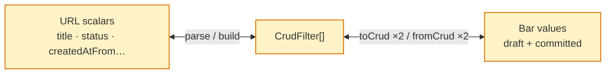

leaf decode ×3 · multi-value ×3 · date bounds ×3 · **~258 duplicated lines**

**After**

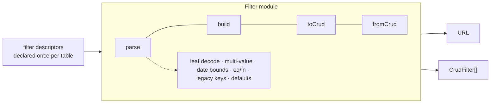

One declaration per filter · one test file · Roles, Tasks, and Users bars consume the same descriptors.

**Problem.** A filter is three representations — URL scalars, `CrudFilter[]`, and bar values — and the conversion between them is written twice or three times: ~258 lines of decode, date-bound, and `eq`/`in` logic.

**Solution.** Let the descriptor module own every conversion, so a filter is declared once and the bars render controls from the same declaration.

**Wins**

- locality: add a filter in one object
- delete ~258 triplicated lines
- one test surface for encoding
- bars stop re-deriving chips
- URL and API cannot drift
- interface shrinks; implementation absorbs the copies

> **ADR note.** Extends ADR-0016/0018 rather than contradicting them: the shared adapter gains the `CrudFilter` direction. ADR-0015's rejection of a shared `useTable` wrapper is untouched.

---

## 2. Absorb the table shell into one deep module

**Strength:** Strong · **in-process**

**Files**

- `apps/web/src/features/roles/components/roles-table.tsx` (482)
- `apps/web/src/features/tasks/components/tasks-table.tsx` (458)
- `packages/shared-lib/src/hooks/url-table-state.ts`
- `packages/shared-lib/src/components/{table-grid,table-pagination}.tsx`

**Before**

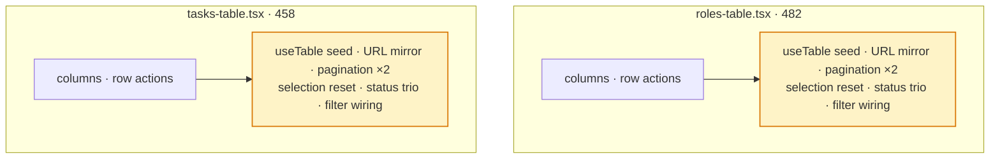

146 lines identical between the two · URL mirror byte-identical

**After**

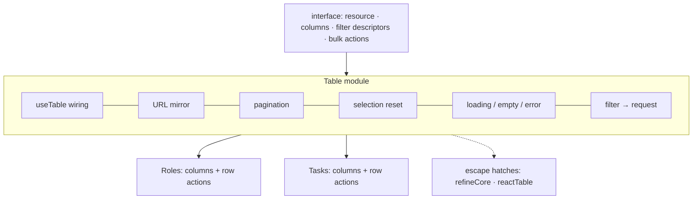

**Problem.** `useTable` is a large, unabsorbed interface: each table re-implements URL mirroring, selection reset, dual pagination, and the loading/error/empty trio, and 146 lines are identical between Roles and Tasks.

**Solution.** A table module takes resource, columns, filter descriptors, and bulk actions and owns the rest; feature files keep only their columns and row actions.

**Wins**

- leverage: one interface, every table
- half of each table's lines disappear
- locality: URL and selection bugs
- status trio written once
- tests hit one interface
- feature files read as configuration

> **Contradicts ADR-0015** ("a new shared wrapper around `useTable` would hide the options that make it useful"), but worth reopening: the second consumer now exists and ~48% of each table is the same. Expose `refineCore` and `reactTable` on the interface so Refine's options stay reachable.

---

## 3. Retire the legacy table path

**Strength:** Strong · **in-process**

**Files**

- `apps/web/src/features/users/components/users-table.tsx` (284)
- `apps/web/src/features/users/components/users-filter-bar.tsx`
- `packages/shared-lib/src/hooks/use-table-state.ts` (206)
- `packages/shared-lib/src/components/data-table.tsx` (108)
- `apps/web/test/table-loading-skeleton.test.tsx`

**Before**

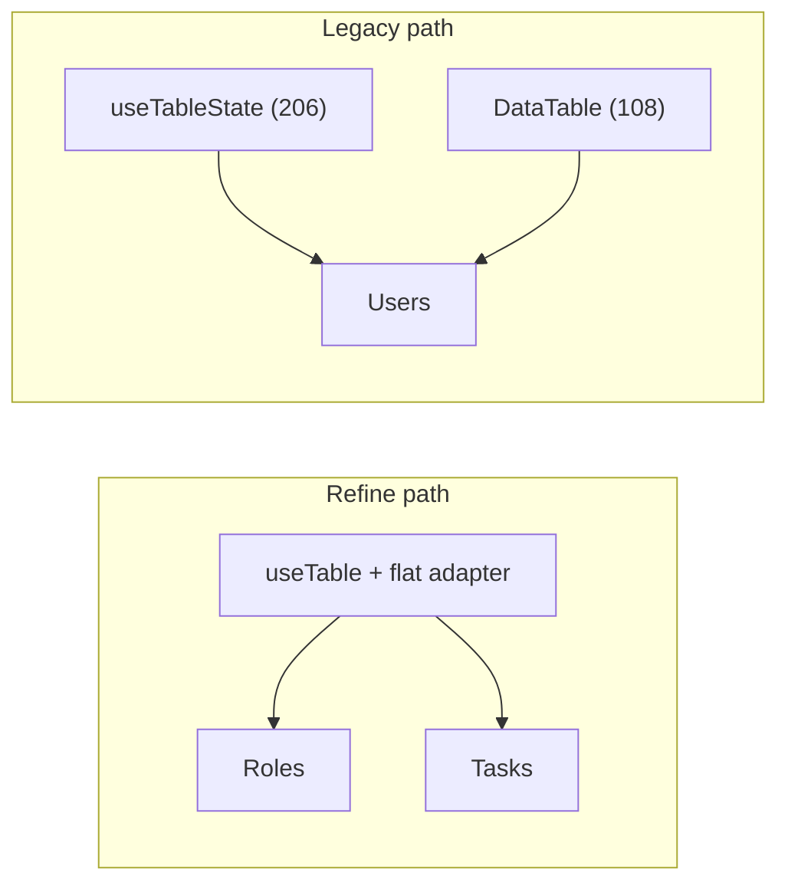

Users has no error branch and no retry.

**After**

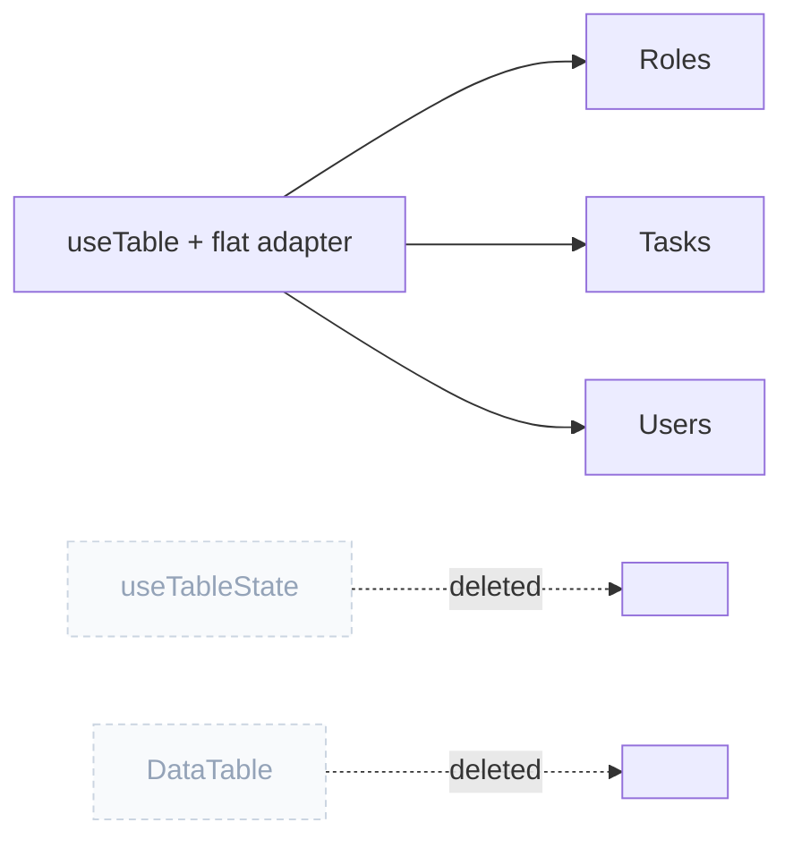

deleted: 314 lines · one URL convention · Users gains inline error + retry + `EmptyList`

**Problem.** `useTableState` and `DataTable` are now single-consumer, duplicating the shared table's state, defaults, and pagination — while Users loses the error/retry/empty trio.

**Solution.** Move Users onto the shared path, then delete both legacy modules and their exports.

**Wins**

- delete 314 lines of competing mechanism
- one URL convention, not two
- Users gains error + retry
- ADR-0015's two-paradigm note closes
- deletion test: complexity concentrates
- one table test surface

> **ADR note.** Consistent with ADR-0015/0018's direction: Users is the last consumer. Sequence it after the table-shell candidate; alone, it creates a fourth near-copy of the bar and table shell.

---

## 4. Collapse the Bulk action lifecycle

**Status (2026-11-21):** implemented in #83 — `useBulkActions` and `useClearIntent` in shared-lib; the third-consumer gate was waived, not met (ADR-0019).

**Strength:** Worth exploring · **in-process**

**Files**

- `apps/web/src/features/roles/hooks/use-roles-bulk-actions.ts` (203)
- `apps/web/src/features/tasks/hooks/use-task-bulk-actions.ts` (147)
- `apps/web/src/features/{roles,tasks}/components/*-bulk-bar.tsx`
- `apps/web/src/features/{roles,tasks}/components/*-bulk-edit-sheet.tsx`

**Before**

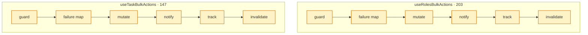

66 shared lines · Roles repeats the notify → invalidate block twice · policy, not resource adaptation

**After**

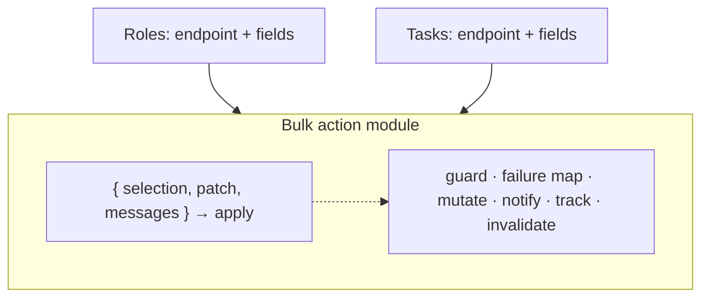

One lifecycle · one failure vocabulary.

**Problem.** Both bulk hooks re-implement the same guard → mutate → notify → track → invalidate pipeline; Roles writes the notify/invalidate block twice, and the sheets copy the dirty-sentinel logic line for line.

**Solution.** One bulk-action module owns the lifecycle; features supply the endpoint, patch fields, and copy.

**Wins**

- one lifecycle interface
- locality: toast and analytics policy
- dirty-field semantics once
- ~66 shared lines deleted
- failures reported uniformly
- Bulk action becomes a domain module

---

## 5. Give the Due date boundary one home

**Strength:** Worth exploring · **local-substitutable**

**Files**

- `packages/api/src/dates.ts` · `packages/api/src/data-handlers.ts`
- `packages/ui/src/lib/date.ts` (≈240)
- `packages/date-utils/src/index.ts` (only parsing)
- `packages/shared-lib/src/hooks/url-table-state.ts`
- `apps/web/src/features/tasks/utils/{filters,task-schema}.ts`

**Before — a call crosses seven thin layers**

| Layer                | Responsibility     | Note               |
| -------------------- | ------------------ | ------------------ |
| `openapi.yaml`       | `dueDate` shape    |                    |
| `schemas.ts`         | read / write split |                    |
| `api/dates.ts`       | normalizers        | **duplicate rule** |
| `data-handlers.ts`   | filter bounds      |                    |
| `ui/lib/date.ts`     | normalizers        | **duplicate rule** |
| `url-table-state.ts` | local day bounds   |                    |
| `task-schema.ts`     | form boundary      |                    |

**After**

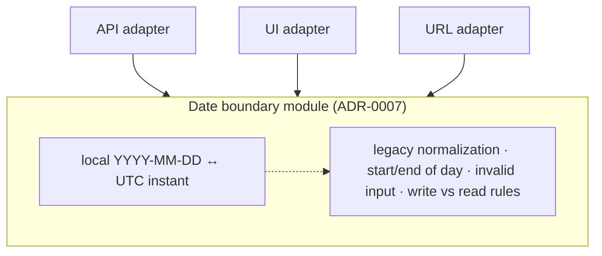

**Problem.** ADR-0007's local-day ↔ UTC-instant rule is normalized in two packages and converted in four more; `date-utils` stops at parsing, so the deep rule is duplicated above it.

**Solution.** Deepen the shared date module to own the boundary and legacy normalization; API and UI keep only their formatting adapters.

**Wins**

- locality: one rule, one suite
- delete two duplicate normalizers
- ADR-0007 enforced once
- filter bounds and forms agree
- `date-utils` becomes deep, not shallow
- two adapters justify the seam

> **ADR note.** Affirms ADR-0007 rather than changing it: the due-date rule moves to one module, with the API and UI as adapters.

---

## 6. Type the Locale dictionary at the call site

**Strength:** Worth exploring · **in-process**

**Files**

- `apps/web/src/utils/translations/en.ts` (353)
- `apps/web/src/utils/translations/vi.ts`
- `apps/web/src/utils/i18n.ts`
- `apps/web/src/features/users/components/users-filter-bar.tsx:45`
- `apps/web/src/features/{roles,tasks}/components/*.tsx`

**Before**

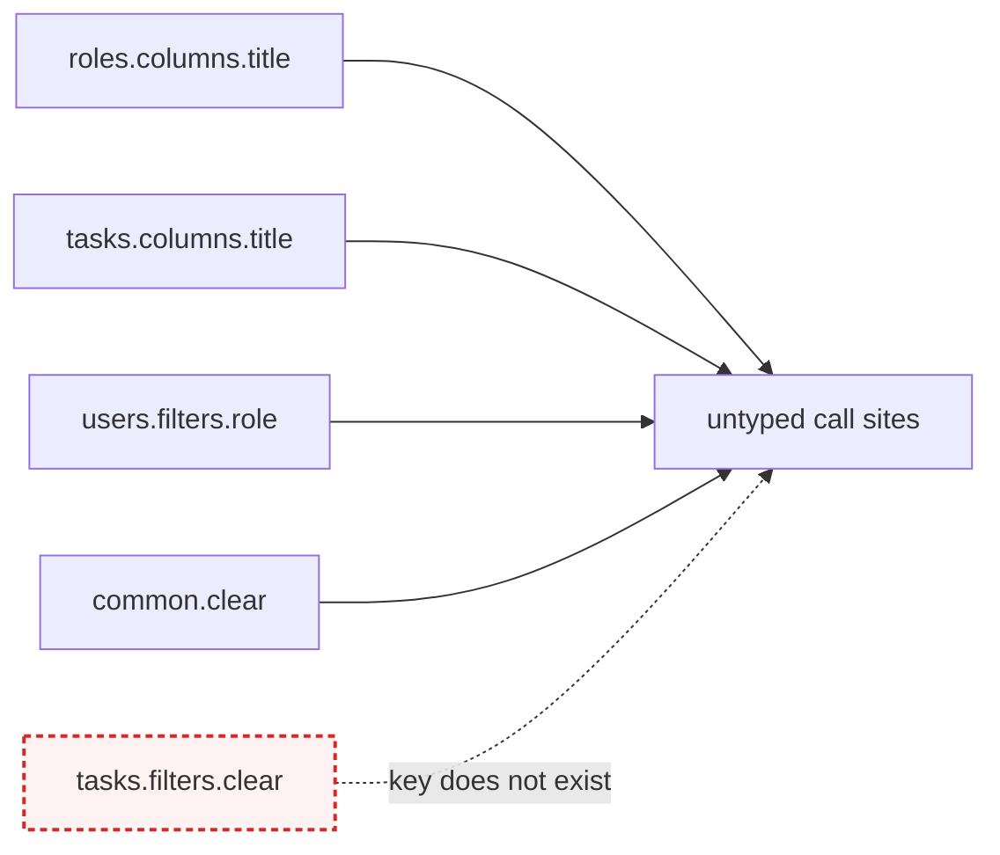

The Users clear button renders the key string. Labels are duplicated 4–7× across namespaces.

**After**

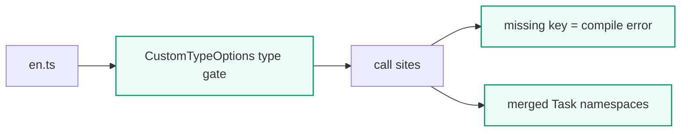

**Problem.** Translation keys are untyped strings across features; `users-filter-bar.tsx:45` calls `tasks.filters.clear`, which does not exist, so the Users clear button renders the key itself.

**Solution.** Augment i18next's `CustomTypeOptions` from `en.ts` and merge the duplicated Task namespaces, making missing keys a typecheck error.

**Wins**

- missing keys fail typecheck
- delete duplicated labels
- locality: one namespace per concept
- no runtime fallback strings
- renames follow the compiler
- interface: one dictionary, checked

> **ADR note.** No conflict with ADR-0004: the Locale stays client-resolved; only the dictionary's type surface changes.

---

## 7. One Role policy module

**Strength:** Worth exploring · **in-process**

**Files**

- `packages/api/src/data-handlers.ts` · `service.ts` · `collections.ts`
- `apps/web/src/providers/access-control-provider.ts`
- `apps/web/src/features/roles/utils/index.ts`
- `apps/web/src/features/users/components/users-table.tsx`
- `apps/web/src/features/tasks/hooks/use-task-rows.ts`

**Before**

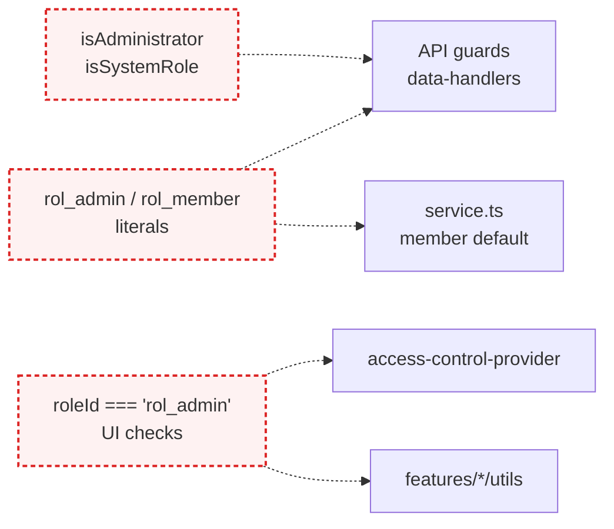

Five encodings of the same policy · server and client can drift.

**After**

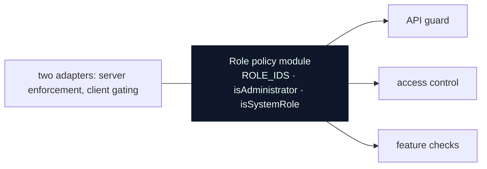

**Problem.** Administrator and System Role knowledge is encoded five ways, with `rol_admin` / `rol_member` literals scattered across the API, providers, and features.

**Solution.** A single policy module exports the ids and predicates; the API guard and client gating become two adapters over it.

**Wins**

- policy changes once
- delete five copies
- server and client cannot drift
- tests at one seam
- two adapters justify the seam
- System Role gains a home in code

> **ADR note.** Compatible with ADR-0003: route gating stays a navigation concern; this module serves both the API guard and the UI gate.

---

## Top recommendation

### [One seam for filters, both directions](#1-one-seam-for-filters-both-directions)

Start here. It removes ~258 duplicated lines, has no ADR conflict, and validates the descriptor interface that the table-shell candidate depends on — the contained half of the bigger prize.

- ~258 lines removed
- one test surface
- unblocks table shell

---

## Verification corrections

Independent re-derivation on 2026-11-21. The analysis above is preserved as written; these supersede its figures and add facts it missed.

### Candidate 1 — overstated

- URL ↔ `CrudFilter[]` is already descriptor-driven and shared (`createTableUrlAdapter`). The feature `url-state.ts` files contain only descriptor declarations.
- The duplication is `CrudFilter[]` ↔ filter-bar values: **91 byte-identical helper lines** (`readLeafFilter` ×3, multi-value reader ×3, `toLocalDateOnly` ×3) plus **~56 parallel operator/date blocks**.
- `combobox-filter.tsx` and `date-range-filter.tsx` are not conversion sites; they should not be counted.
- The bars are hard-coded control by control. "Bars render from the same declaration" is a larger interface change than "one conversion seam", and verification found feature-specific escape hatches (option sources, debounce shape, layouts, no chips on Users).
- Roles validates date input with the `isDateOnly` regex, which accepts overflowed days (`2026-02-31`); Tasks and the URL adapter use `dateOnlyToLocalDate`, which rejects them. The UI boundary helper throws on overflow, so Roles has a latent `RangeError` path.

### Candidate 2 — understated

- The tables share **187 contiguous identical lines (40.8%)**, **249 after normalizing resource names (53%)**, and **106 of 117 lines (91%)** of the state/URL/pagination/selection core.
- Genuinely shareable: `useTable` seed, URL mirror, `refineCore` destructure, pagination/selection handlers, status trio, grid/pagination.
- Not shareable without escape hatches: columns, row actions, permissions, bulk bar, overlay/delete strategy, empty-state behavior, `enableRowSelection` (boolean in Roles vs predicate in Tasks), Roles-only column visibility, and skeleton widths.

### Candidate 3 — confirmed

- One production consumer each; `DataTable` also has one direct test consumer.
- Users has no error branch and no retry (`isError`/`refetch` never referenced) and uses a bare `
` empty state instead of `EmptyList`.
- The Users filter bar uses scalar props, not the `CrudFilter[]` contract, so unification needs an internal prop-contract rewrite. Server pagination and the API already fit; no endpoint or OpenAPI change.
- Tests needing change: `apps/web/test/table-loading-skeleton.test.tsx` (delete/retarget), `apps/web/test/users-filter-bar.test.tsx` (only if the bar contract changes), and the `roleId=` assertions in `apps/web/e2e/users.spec.ts` must stay green.

### Candidate 4 — confirmed

- ~66 identical lines in the update lifecycle (90 non-blank identical lines across the full hooks); Roles repeats notify → invalidate for delete; both sheets copy the dirty-sentinel logic line for line.
- Divergences any shared module must parameterize: endpoints, payload shape, failure vocabulary (Roles' typed enum vs Tasks' string), selection gating (resource-level vs per-row), analytics payload (`fields`), delete presence, and `isApplying` shape.

### Candidate 5 — confirmed, with a behavioural disagreement

- The API and UI read-normalizers encode the same rule but **disagree on overflowed date-only input**: `2026-02-31` becomes `null` in the API and throws `RangeError` in the UI. No test pins either.
- `packages/date-utils` is dependency-free and already declared by both API and UI, so a deeper normalizer there is feasible without a cycle.
- ADR-0007 is consistent with the code; the write path is stricter in implementation than the ADR's wording.

### Candidate 6 — confirmed, one live key

- `t("tasks.filters.clear")` at `users-filter-bar.tsx:45` is the **only** real missing key out of 242 distinct literals used; `tasks.filters.clearAll` and `common.clear` exist.
- `CustomTypeOptions` is viable with the current i18next setup; no augmentation exists today.
- 41 duplicate value groups, 39 spanning namespaces.
- No test pins translation keys or missing-key behaviour.

### Candidate 7 — overstated and understated

- **Six** non-test copies, not five.
- `packages/api/src/service.ts` and `collections.ts` contain no authorization guards; they hold the registration default and seed data only.
- Real client drift: the API blocks System Role deactivation and deletion, but the client only hides Delete; the edit drawer and bulk edit can still submit `inactive` and receive `409 system_role`.
- Package constraint: the shared module must live in `packages/api` (browser-safe export) or a new leaf package; `shared-lib` would create an `api → shared-lib → api` cycle and `ui` is a design-system boundary.
